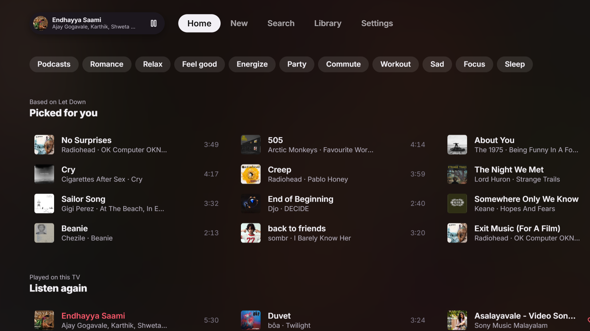
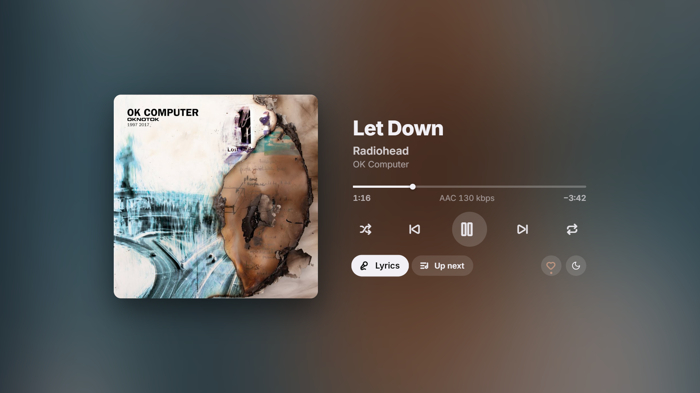

# BitChord for Samsung TV

A YouTube Music player for Samsung Smart TVs, designed for the remote. A Tizen port of [BitChord](https://github.com/jackychan4891/BitChord-PC-Official).

| | |
|---|---|
|  |  |

## Features

**Listening**
- Home feed with mood chips, plus "Picked for you" and "Listen again", learned from what you play on the TV.
- New releases, charts, and moods & genres.
- Album, playlist and artist pages.
- Search with live suggestions and recent searches. Results show songs only, never videos.
- Autoplay continues with similar songs when the queue ends.

**Now Playing**
- The background is a soft, slowly moving colour field taken from the cover.
- Synced lyrics light up word by word where the source has word timing. Upcoming lines are softly blurred, Apple Music style.
- Hide the lyrics for a large cover beside the song details, or switch to Up next.
- Shuffle, repeat, like, a sleep timer, and a seek bar that marks your position clearly.

**Built for the TV**
- Every screen works with the arrow keys, OK and Back. Each row remembers where you were, holding an arrow speeds up, and holding OK opens a menu of actions.
- An on-screen keyboard in English, German, Spanish, French and Russian, plus symbols.
- Media keys work everywhere, and number keys type on the keyboard.
- Now Playing is always one press away from the sidebar.
- A reduced-motion setting, and accessible labels on every control.

**Library on the TV**
- Liked songs, saved albums and playlists, and listening history, stored on the TV with no account needed.

## How it works

The app talks to YouTube Music directly from the TV. It has no server or proxy and collects no data.

- **Music:** catalogue requests use YouTube Music's own web API. Audio streams as AAC, fed fragment by fragment through Media Source Extensions, so long songs play and seek reliably on Tizen.
- **Lyrics:** from Unison, lrc.red and LRCLIB, three free community sources that need no key.
- **Runtime:** plain JavaScript (ES2017) with no build step, written for Tizen 4.0 and later.

## Requirements

- A Samsung Smart TV running Tizen 4.0 or later (2018 models and newer). Tested on Tizen 6.5.
- Developer Mode on the TV, and Tizen Studio with a Samsung certificate on a computer.

## Installation

Each [release](../../releases) is an unsigned `.wgt`. Samsung TVs only install apps signed for that specific TV, so sign the package with your own Samsung TV certificate in Tizen Studio, then install it over Developer Mode.

## Limitations

- **No account sign-in.** Google's sign-in can't run inside a Tizen web app. The library is stored on the TV instead.
- **Playback stops in the background.** Music may stop when you switch to another TV app.
- **Lyrics coverage.** Lyrics come from community sources, and some songs have none.

## Credits

- **BitChord:** a port of BitChord by jackychan4891 (PC) and kushagrasinghx (Android, TV and web).
- **Fonts:** Inter and Figtree (SIL Open Font License).
- **Icons:** Lucide (ISC License).

## License

[GPL-3.0](LICENSE), the same licence as BitChord.

This project is not affiliated with Google, YouTube or Samsung. YouTube Music provides the music, artwork and metadata.
