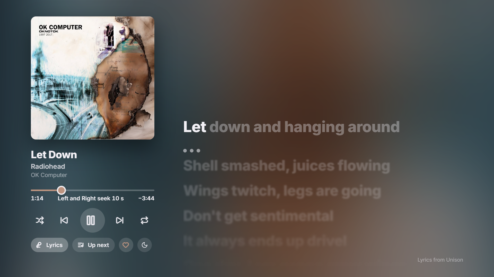
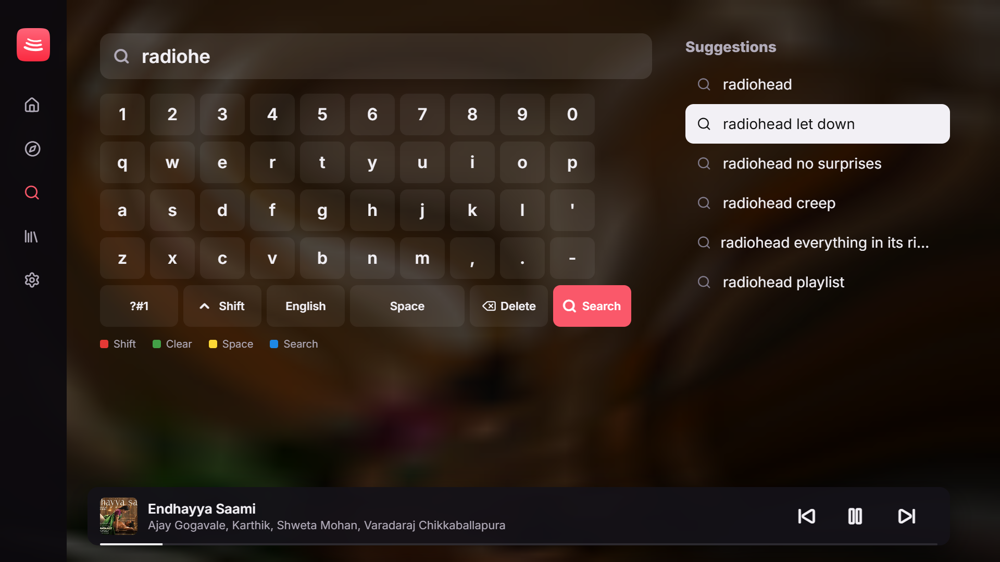

# BitChord for Samsung TV

A Tizen port of [BitChord](https://github.com/jackychan4891/BitChord-PC-Official) for Samsung TVs, built for the remote. It plays music from YouTube Music, with word-synced lyrics and BitChord's cover-driven backdrop. There's no server: the TV talks to YouTube Music directly.


**Status: 0.3.0, third test build.**
- **Verified on a TV** (Tizen 6.5): every request the app makes works from a packaged app, and AAC playback works. The probe in [`probe/`](probe/) checked this.
- **Verified in a headless browser:** the full app, with real YouTube data and the arrow keys as a remote.
- **Not yet run on a TV:** the full app itself. Please report what you see.

| | |
|---|---|
|  |  |

## Install on your TV

The release `.wgt` is **unsigned**. Samsung TVs only install apps signed with your own Samsung certificate, which carries your TV's ID (DUID). Sign it the same way as the probe.

1. Install Tizen Studio with **Samsung TV Extensions** and **Samsung Certificate Extension** (Package Manager).
2. **Developer Mode:**
   1. On the TV, open Apps and press `1 2 3 4 5`.
   2. Switch Developer mode On and enter your PC's IP address.
   3. Restart the TV.
3. Connect, then note the target name the second command prints (for example `UE55CU7100`):

   ```bash
   C:\tizen-studio\tools\sdb.exe connect <TV_IP>
   ```

   ```bash
   C:\tizen-studio\tools\sdb.exe devices
   ```

4. **Certificate:** in Tizen Studio's Certificate Manager, use the `bctv` Samsung TV profile you made for the probe, or create one with the TV connected.
5. Download `BitChord-0.3.0-unsigned.wgt` from [Releases](../../releases), then sign, install and start it:

   ```bash
   C:\tizen-studio\tools\ide\bin\tizen.bat package -t wgt -s bctv -- BitChord-0.3.0-unsigned.wgt
   ```

   ```bash
   C:\tizen-studio\tools\ide\bin\tizen.bat install -n BitChord-0.3.0-unsigned.wgt -t <target>
   ```

   ```bash
   C:\tizen-studio\tools\ide\bin\tizen.bat run -p bchordtv01.BitChord -t <target>
   ```

   If the first command won't sign the downloaded file, unzip it into a folder named `app` and run `tizen.bat package -t wgt -s bctv -- app` instead.

The app's package ID (`bchordtv01`) differs from the probe's, so both can stay installed.

**Emulator:** start a TV emulator in Emulator Manager and use its target name (for example `emulator-26101`). Emulators can treat network requests and codecs differently from a real TV.

**Debugging on the TV:** `sdb shell 0 debug bchordtv01.BitChord` prints a port. Open `http://<TV_IP>:<port>` in Chrome for DevTools.

## Using it

| Key | What it does |
|---|---|
| Arrows | Move. Hold to go faster. |
| OK | Open or play. Hold for half a second to open a menu: Play next, Add to queue, Start radio, Like, Save, Go to artist. |
| Back | Close a menu, then leave Now Playing, then go up a page, then (on Home) ask to exit. |
| Play/Pause, Stop, Next, Previous | Control playback from any screen. |
| Fast-forward / Rewind | Seek 10 s; on the keyboard, move the cursor. |
| 0–9 | On the keyboard: type a digit. |

Starting a song opens Now Playing. Back leaves it. To return, press Left for the sidebar and choose **Now Playing** at the top. Likes, saved albums and playlists, and history are kept on the TV. Signing in with a YouTube account isn't available yet (see below).

## Develop

The app is plain JavaScript (ES2017) with no build step, so it runs on Tizen 4 and later. The widget lives in `app/`.

To run it in Chrome as the TV would, start the dev server:

```bash
npx -y http-server@14.1.1 . -p 5180 -c-1 -s
```

Then open `http://localhost:5180/app/index.html` in a Chrome started with `--disable-web-security --user-data-dir=<temp folder>`. The flag stands in for the TV, which doesn't block cross-origin replies for packaged apps. It's a test-only flag; the app itself has no proxy.

| Command | What it does |
|---|---|
| `npm test` | Parser tests on real YouTube captures, lyric parsers, the nav engine and keyboard (headless Chrome), and a gate against anything Chromium 76 can't run |
| `node test/journey.js` | Walks every screen with the arrow keys and saves 1920×1080 screenshots to `test/shots/` (needs the dev server) |
| `node test/perf.js` | Start-up time, frame rate and memory with the CPU slowed 6× |
| `node tools/icons.js` | Renders the icon, store icons, splash and banner from the brand SVG |
| `npm run package` | Writes `build/BitChord-<version>-unsigned.wgt` |

Tests use Chrome at `C:/Program Files/Google/Chrome/Application/chrome.exe`; set `CHROME` to use another.

## Docs

| Doc | What it covers |
|---|---|
| [docs/FEATURE_MATRIX.md](docs/FEATURE_MATRIX.md) | Every PC feature on PC, Android TV and Tizen, and why anything is missing |
| [docs/DESIGN_SPEC.md](docs/DESIGN_SPEC.md) | Colour, type, shape, motion, backdrop and lyric values from the PC source |
| [docs/WORKFLOWS.md](docs/WORKFLOWS.md) | Each flow, key by key |
| [docs/PARITY.md](docs/PARITY.md) | Done, Partial, Not possible, Removed |
| [docs/PERFORMANCE.md](docs/PERFORMANCE.md) | Start-up, frame rate and memory, and how to measure on the TV |
| [docs/STORE_SUBMISSION.md](docs/STORE_SUBMISSION.md) | Why to sideload rather than submit, and the store assets |

## Sign-in: an open question

The PC app signs in through a browser window, then sends Google's session cookie with every request. A Tizen web app can't do that: JavaScript may not set a `Cookie` header, and the app can't run the small local server Android TV uses for phone pairing. Account features (synced library, likes, history, personalized Home) need a different route, so that decision is still open.

## Licence

GPL-3.0, the same as BitChord. A port of BitChord by jackychan4891 (PC) and kushagrasinghx (Android, TV and web).
- **Fonts:** Inter and Figtree (SIL Open Font License).
- **Icons:** Lucide (ISC).

Music, artwork and metadata come from YouTube Music; lyrics come from Unison, lrc.red and LRCLIB. This project isn't affiliated with Google, YouTube or Samsung.
